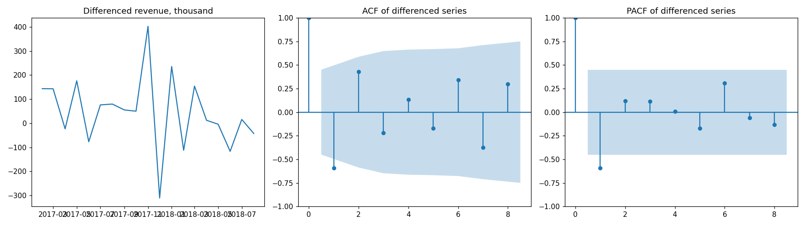

# Financial Time Series Forecasting (ARIMA / ETS, Python + R)

Monthly revenue forecasting for an e-commerce marketplace: raw transactional tables → clean monthly series →
stationarity checks → ARIMA and ETS models → **out-of-sample backtesting against simple benchmarks**.

Python is used for data preparation and a baseline model, R (`forecast`) for model selection and backtesting.

## Data

- **Source:** [Brazilian E-Commerce Public Dataset by Olist](https://www.kaggle.com/datasets/olistbr/brazilian-ecommerce) — ~100k orders, 2016–2018
- **Revenue definition:** sum of payments of delivered orders, by purchase month (BRL)
- Raw CSVs are not stored in the repo: download them from Kaggle or
  [Google Drive](https://drive.google.com/drive/folders/1FeDjNPot8-LrITfVb58msrz1AUJUPZaT) into `data/raw/`
- Model input: [`data/processed/monthly_revenue.csv`](data/processed/monthly_revenue.csv) — 20 months, Jan 2017 – Aug 2018

**Series boundaries.** Sep–Dec 2016 is the marketplace's test period (November 2016 has no orders, December 2016 a
single order), so the series starts in January 2017 — otherwise the monthly index has a gap and `ts()` shifts every
later month. Delivered orders effectively stop after August 2018, so the series ends there.


Revenue grew fast through 2017 and **flattened in 2018** at about 1.0–1.1M per month. With 20 points (less than two
full years), annual seasonality cannot be estimated, so all models are non-seasonal.

## Workflow

**Python** — [`notebooks/revenue_preprocessing_and_baseline.ipynb`](notebooks/revenue_preprocessing_and_baseline.ipynb)
- Merge orders and payments, compute order revenue, aggregate by month, check for missing months
- ADF test: level p = 0.18 (unit root) → first difference p < 0.001 → **d = 1**
- ACF/PACF of the differenced series: one significant negative spike at lag 1 → low-order AR term
- Baseline ARIMA(1,1,0) with drift on a 6-month holdout vs a naive forecast

**R** — [`r_analysis/arima_ets_forecasting.R`](r_analysis/arima_ets_forecasting.R)
- `auto.arima` (non-seasonal, full search) and `ets` on the full series, residual diagnostics
- Backtesting: models re-selected on Jan 2017 – Feb 2018 and evaluated on Mar – Aug 2018,
  plus rolling-origin one-step-ahead errors (`tsCV`) over the same six months
- Benchmarks: naive (last value) and random walk with drift
- Full console output: [`data/processed/r_output.txt`](data/processed/r_output.txt), metrics: [`data/processed/model_metrics.csv`](data/processed/model_metrics.csv)



## Selected models (full series)

| Model | Chosen by | In-sample RMSE | Residuals (Ljung-Box) |
|---|---|---:|---|
| ARIMA(1,1,0) with drift | `auto.arima`, AICc | 115,890 | no autocorrelation (p = 0.87) |
| ETS(A,N,N) | `ets`, AICc | 141,894 | no autocorrelation (p = 0.16) |

In-sample error only shows how well a model fits data it has already seen; the choice below is made on
out-of-sample errors.

## Backtesting results

Forecasts made at the end of February 2018 for March–August 2018 (models re-selected on the training window only):

| Model | RMSE | MAE | MAPE | Bias |
|---|---:|---:|---:|---:|
| **Naive (last value)** | **118,334** | **101,465** | **9.2%** | −101,465 |
| Random walk + drift | 207,972 | 166,737 | 16.3% | +124,410 |
| ARIMA(1,1,0) with drift | 271,110 | 215,262 | 21.1% | +215,262 |
| ETS(M,A,N) | 299,408 | 246,552 | 24.0% | +246,552 |

Rolling one-step-ahead forecasts over the same six months (each month re-fitted on all earlier data):

| Model | RMSE | MAE |
|---|---:|---:|
| **Naive** | **81,260** | **57,595** |
| Random walk + drift | 98,796 | 87,915 |
| ARIMA (re-selected each month) | 127,929 | 106,831 |
| ETS (re-selected each month) | 275,801 | 227,744 |


## Key findings

- **The naive forecast wins.** Both trend models, trained on the 2017 growth phase, keep extrapolating growth and
  overestimate the 2018 plateau by about 20% (bias +215k for ARIMA, +247k for ETS per month).
- **ARIMA beats ETS** on every out-of-sample measure, but neither beats the simplest benchmark. Choosing a model by
  in-sample fit or AIC alone would have selected a model that is worse than "same as last month".
- **The regime changed in 2018:** growth stopped. Models fitted to the growth phase cannot see this until enough
  plateau data accumulates — a classic structural-break problem.
- **Stationarity tests are weak on 20 points:** the Python ADF test (constant, AIC lag choice) rejects a unit root
  for the first difference, while `tseries::adf.test` (trend, 2 lags) does not. d = 1 is chosen on the visual trend and
  the Python test, and is the order `auto.arima` selects.

## Business interpretation

- For budgeting in a market that has stopped growing, a flat (naive) forecast is the safer baseline;
  trend models here would have overstated revenue by ~200k BRL per month.
- Use **rolling re-forecasting** and always compare a model against a naive benchmark before trusting it.
- Monitor forecast bias: a run of same-sign errors is an early signal of a regime change.
- Longer history (2+ years) is needed before seasonal models can be considered.

### 6-month forecast from the full series (for illustration)


Given the backtest, this trend forecast should be read as an optimistic scenario, with the naive forecast as the base case.

## How to run

```bash
# Python (pandas, numpy, matplotlib, statsmodels, jupyter)
jupyter nbconvert --to notebook --execute --inplace notebooks/revenue_preprocessing_and_baseline.ipynb
```
```r
# R (readr, dplyr, ggplot2, forecast, tseries), from the repository root
source("r_analysis/arima_ets_forecasting.R")
```

## Author

**Konstantin Rudnev** — Business & Product Analyst
[LinkedIn](https://www.linkedin.com/in/konstantin-rudnev-a96727354) · [GitHub](https://github.com/Konstantin667)

## License

MIT
