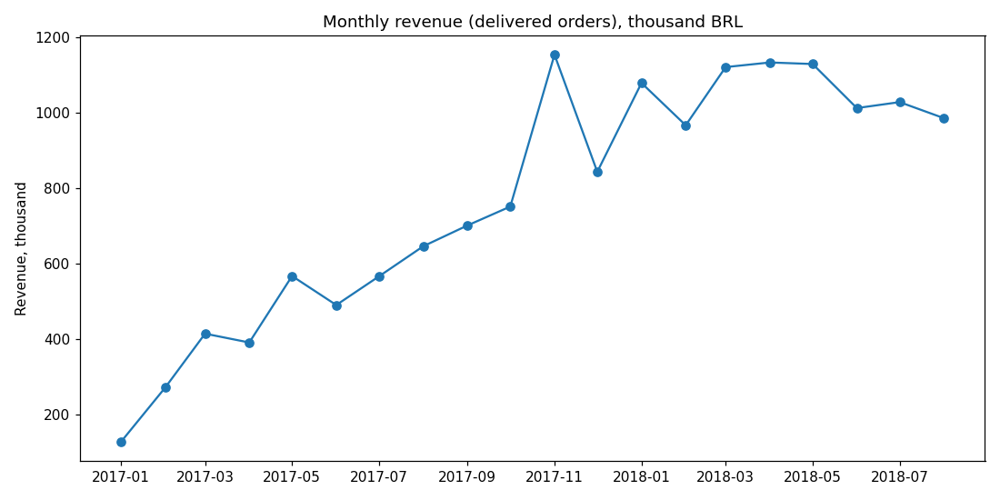
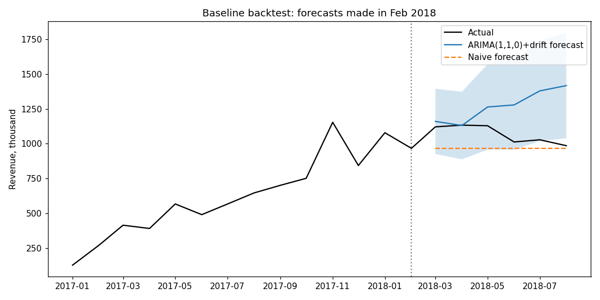
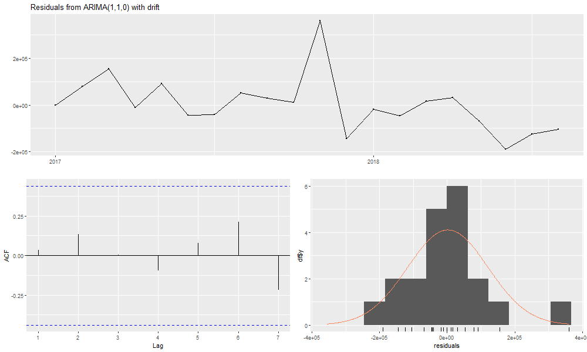
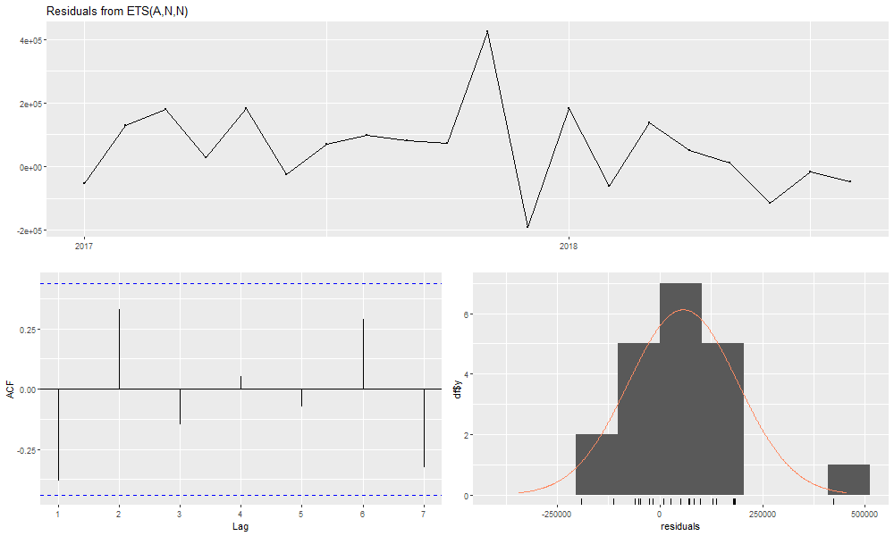
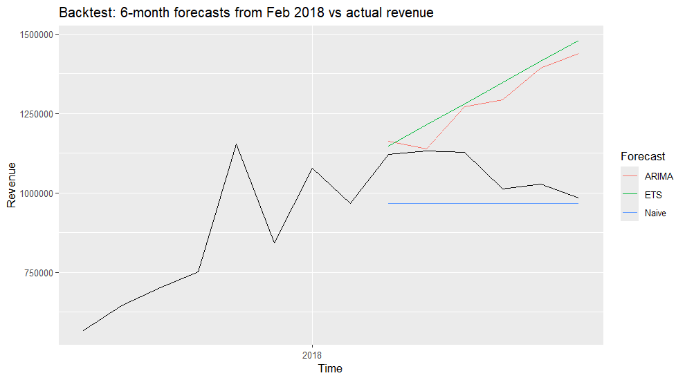
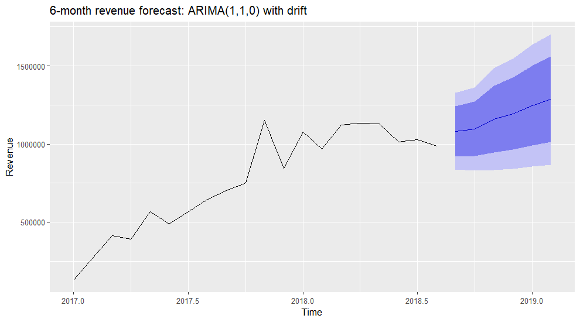

# Financial Time Series Forecasting (ARIMA / ETS, Python + R)

This project demonstrates an end-to-end time series forecasting pipeline for business revenue data, combining Python
for data preprocessing and R for statistical time series modeling and validation.

The goal is to simulate a realistic analytics workflow: raw transactional data is transformed into a clean monthly
revenue series, classical forecasting models are fitted, and — most importantly — they are **tested on data they have
not seen** and compared with simple benchmarks before any of them is trusted for business decisions.

---

## Project Overview

**Key objectives:**
- Build a clean monthly revenue time series from raw transactional data
- Check data boundaries and gaps before modeling
- Test stationarity and choose the order of differencing
- Compare forecasting models:
  - ARIMA (selected with `auto.arima`)
  - ETS (Exponential Smoothing State Space, selected with `ets`)
  - Benchmarks: naive (last value) and random walk with drift
- Evaluate models out of sample: 6-month holdout and rolling-origin one-step forecasts
- Translate the results into practical recommendations for revenue planning

---

## Tools & Technologies

- **Python**: pandas, numpy, matplotlib, statsmodels
- **R**: readr, dplyr, ggplot2, forecast, tseries
- **Methods**: ADF test, ACF/PACF analysis, ARIMA, ETS, residual diagnostics (Ljung-Box), holdout and rolling-origin backtesting (`tsCV`), RMSE / MAE / MAPE / bias
- **Data source**: Brazilian E-Commerce Public Dataset (Olist)

---

## Dataset Overview

The project uses the **Olist Brazilian E-Commerce Public Dataset**, which contains real transactional data from a
large Brazilian online marketplace.

The dataset includes:

- ~100,000 orders placed between 2016 and 2018
- Customer, seller, product, and geolocation data
- Order lifecycle timestamps (purchase, approval, delivery)
- Payment values and installment information
- Product categories (translated to English)

For this project, the dataset was used to **reconstruct historical revenue** from order and payment tables, reflecting
how raw operational data is typically handled in real companies rather than starting from a pre-aggregated series.

**Revenue definition:** sum of payments of **delivered** orders, assigned to the month of purchase (BRL).

**Original dataset (Kaggle):**
https://www.kaggle.com/datasets/olistbr/brazilian-ecommerce

---

## Data Availability

Due to file size limitations, raw CSV files are not stored in this repository.

**Raw datasets (Google Drive):**
https://drive.google.com/drive/folders/1FeDjNPot8-LrITfVb58msrz1AUJUPZaT

Place them into `data/raw/` before running the notebook.

**Processed dataset used for modeling:**
[`data/processed/monthly_revenue.csv`](data/processed/monthly_revenue.csv) — 20 consecutive monthly observations,
January 2017 – August 2018. It is produced by the Python notebook and is the input of the R script.

### Series boundaries

- **Start — January 2017.** September–December 2016 is the marketplace's test period: November 2016 has no orders at
  all and December 2016 has a single order (19.62 BRL). Keeping these months would put a gap into the monthly index —
  `ts()` assumes consecutive months, so every later month would be shifted by one.
- **End — August 2018.** Purchases are recorded until October 2018, but delivered orders effectively stop after August.
  Orders still in transit at the end of the data are excluded by the `delivered` filter; for the last months this
  lowers revenue by only about 1%.



Revenue grew quickly through 2017 (from 0.13M to 1.15M per month, with a Black Friday peak in November 2017) and then
**flattened in 2018** at about 1.0–1.1M per month. With 20 observations — less than two full years — annual
seasonality cannot be estimated, so all models in this project are non-seasonal.

---

## Workflow Summary

### Python (Data Preparation & Baseline Modeling)

[`notebooks/revenue_preprocessing_and_baseline.ipynb`](notebooks/revenue_preprocessing_and_baseline.ipynb)

- Load orders and payments tables
- Aggregate payments to order level and merge with orders
- Keep delivered orders with a payment record
- Aggregate revenue to monthly frequency and check for missing months
- Cut the series to complete, consecutive months (Jan 2017 – Aug 2018)
- Test stationarity with the **ADF test**, inspect the differenced series, ACF and PACF
- Fit a baseline **ARIMA(1,1,0) with drift** on a 6-month holdout and compare it with a naive forecast

### R (Forecasting & Validation)

[`r_analysis/arima_ets_forecasting.R`](r_analysis/arima_ets_forecasting.R)

- Import the processed monthly series and convert it into a `ts` object
- ADF tests (`tseries`) on the level and differenced series
- Select models automatically on the full series: `auto.arima` (non-seasonal, full search) and `ets`
- Residual diagnostics: residual plots, ACF, distribution, Ljung-Box test
- **Backtesting:** re-select both models on January 2017 – February 2018 only (no look-ahead) and forecast
  March – August 2018; compare with naive and drift benchmarks
- **Rolling-origin evaluation** (`tsCV`): one-step-ahead forecasts for each of the last six months, re-fitting on all earlier data
- Save metrics and charts; full console output is in [`data/processed/r_output.txt`](data/processed/r_output.txt)

---

### Forecast Model Comparison

**6-month holdout** — forecasts made at the end of February 2018 for March–August 2018:

| Model | RMSE | MAE | MAPE | Bias |
|---|---:|---:|---:|---:|
| **Naive (last value)** | **118,334** | **101,465** | **9.2%** | −101,465 |
| Random walk + drift | 207,972 | 166,737 | 16.3% | +124,410 |
| ARIMA(1,1,0) with drift | 271,110 | 215,262 | 21.1% | +215,262 |
| ETS(M,A,N) | 299,408 | 246,552 | 24.0% | +246,552 |

**Rolling one-step-ahead forecasts** over the same six months:

| Model | RMSE | MAE |
|---|---:|---:|
| **Naive** | **81,260** | **57,595** |
| Random walk + drift | 98,796 | 87,915 |
| ARIMA (re-selected each month) | 127,929 | 106,831 |
| ETS (re-selected each month) | 275,801 | 227,744 |

All metrics: [`data/processed/model_metrics.csv`](data/processed/model_metrics.csv).

**Key insights:**

- The **naive forecast has the lowest error** in both evaluations
- Both trend models **overestimate** the 2018 revenue (positive bias in every case)
- **ARIMA outperforms ETS** on every out-of-sample metric, so it is the better of the two statistical models
- Neither statistical model beats the simplest benchmark after the 2018 plateau — the main result of the project

---

## Example Outputs

### Stationarity Check, ACF and PACF


The original monthly revenue series has a clear upward trend. The ADF test in Python does not reject a unit root for
the level series (ADF = −2.27, p = 0.18) but strongly rejects it after first-order differencing (ADF = −8.07,
p < 0.001), so the order of differencing is set to **d = 1**.

The ACF and PACF of the differenced series show a single significant **negative** spike at lag 1 and nothing
significant afterwards. This points to a low-order AR term — a month of unusually high growth tends to be followed
by a weaker one (for example, the November 2017 Black Friday peak followed by December).

Note: with only 19 differenced observations, ADF tests have low power. The `tseries::adf.test` version (with trend and
two lags) does not reject a unit root even for the differenced series, while the Python test (constant, lag chosen by
AIC) does. The decision d = 1 relies on the visual trend, the Python test and the order chosen by `auto.arima`.

### Python – Baseline ARIMA Backtest



A baseline ARIMA(1,1,0) with drift is trained on January 2017 – February 2018 and forecasts March – August 2018.
The model extrapolates the 2017 growth: its forecast keeps rising while actual revenue stays flat, overestimating
revenue by about 200k BRL per month on average (MAPE 20%). The naive forecast (dashed line) is much closer (MAPE 9%).

### R – ARIMA Model and Residual Diagnostics



On the full series, `auto.arima` selects **ARIMA(1,1,0) with drift** (AR coefficient −0.59, drift ≈ 45k per month).
Residuals show no significant autocorrelation (Ljung-Box p = 0.87) and are roughly symmetric, with one large outlier
in November 2017 (Black Friday). In-sample RMSE: 115,890.

### R – ETS Model Residual Diagnostics



On the full series, `ets` selects **ETS(A,N,N)** — simple exponential smoothing without a trend (α = 0.72). Its
residuals are mostly positive (the model lags behind the growth) and the in-sample RMSE is higher (141,894). On the
shorter training window used for backtesting, `ets` selects **ETS(M,A,N)** — a model with an additive trend, which
then extrapolates the 2017 growth.

### Backtesting: Forecast vs Actual



From February 2018, both ARIMA and ETS forecast continued growth (towards 1.4–1.5M by August 2018), while actual
revenue flattened at about 1.0–1.1M. The naive forecast, which simply repeats the February value, stays close to the
actual series for the whole horizon.

### R – 6-Month Forecast from the Full Series



The ARIMA model fitted on all 20 months forecasts further growth for September 2018 – February 2019, with confidence
intervals widening over the horizon. Given the backtest, this should be read as an **optimistic scenario**, with a
flat (naive) forecast as the base case.

---

## Key Learnings

- **Check the data boundaries before modeling.** The raw monthly aggregate contained a missing month and two
  near-empty months at the start; left in, they shifted the time index and distorted the stationarity tests.

- **In-sample fit is not forecast accuracy.** ARIMA had a good in-sample fit and clean residuals, but out of sample it
  was more than twice as wrong as the naive forecast. Model choice must be based on errors on unseen data.

- **Always compare with a naive benchmark.** Without it, ARIMA would have been declared "the best model" simply because
  it beat ETS.

- **Regime changes break trend models.** Revenue growth stopped in 2018. Models trained on the growth phase cannot know
  this until enough plateau data accumulates, so they keep extrapolating the old trend — a structural-break problem.

- **Short series limit what can be modeled.** With 20 monthly points, seasonality cannot be estimated and stationarity
  tests have low power; conclusions should be stated with that uncertainty.

- **Forecast bias is a useful signal.** Errors of the same sign month after month (here: every model except naive
  overestimates) are an early indicator that the underlying dynamics have changed.

---

## Business Interpretation

The results provide practical guidance for revenue planning and risk management:

• In a market that has stopped growing, a **flat (naive) forecast is the safer budgeting baseline**: the trend models
  here would have overstated revenue by about 200k BRL per month, i.e. more than 20%.
• Forecasts should be produced with **rolling re-forecasting**: re-fit every month and track errors against a naive benchmark.
• **Bias monitoring** (consistent over- or under-forecasting) should trigger a review of growth assumptions.
• Trend-based forecasts are still useful as an **upside scenario** for planning capacity and marketing budgets.
• At least two full years of history are needed before **seasonal models** (e.g. for the Black Friday peak) can be considered.

From a business perspective, the pipeline supports:

• Monthly budgeting and cash flow planning
• Scenario analysis for revenue growth or slowdown
• Early detection of deviations from expected performance

---

## How to Run

```bash
# Python: pandas, numpy, matplotlib, statsmodels, jupyter
jupyter nbconvert --to notebook --execute --inplace notebooks/revenue_preprocessing_and_baseline.ipynb
```

```r
# R: readr, dplyr, ggplot2, forecast, tseries — run from the repository root
source("r_analysis/arima_ets_forecasting.R")
```

---

## Author

**Konstantin Rudnev**
Business & Product Analyst
Open to opportunities across Europe

[LinkedIn](https://www.linkedin.com/in/konstantin-rudnev-a96727354) · GitHub: https://github.com/Konstantin667

## License
This project is licensed under the MIT License.
